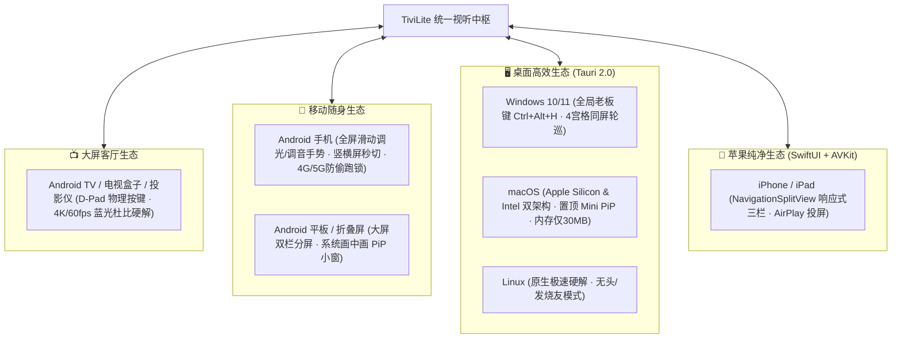

# TiviLite (灵动TV) - 全平台全场景开源纯净播放器

<p align="center">
  
</p>

<p align="center">
  <a href="https://github.com/fullofjoy/tivilite/releases"></a>
  <a href="#"></a>
  <a href="#"></a>
  <a href="#"></a>
  <a href="LICENSE"></a>
</p>

---

## 📺 项目愿景与多终端定位

**TiviLite (灵动TV)** 是一款对标国际标杆 TiviMate 的全平台、超轻量、超高颜值的专业级媒体流播放器。

针对传统播放器“收费昂贵、手机与平板体验糟糕、跨设备无法同步、换台黑屏卡顿、配源输入繁琐”等核心痛点，TiviLite 现已实现**大屏电视 (TV)、智能手机 (Phone)、平板电脑 (Tablet)、桌面电脑 (Windows / macOS / Linux) 以及苹果生态 (iOS / iPadOS) 的全场景同频覆盖**。



---

## 📥 各终端最新安装包与下载中心 (v2.1.0)

所有终端官方正式包均托管于 [GitHub Releases](https://github.com/fullofjoy/tivilite/releases/tag/v2.1.0)，并提供全端源码打包下载：

| 适用终端 / 操作系统 | 推荐安装格式 | 安装包特征与技术规范 | 官方下载通道 |
| :--- | :---: | :--- | :---: |
| 📺 **Android TV / 电视盒子** | `.apk` | 7.56 MB，专为客厅远距离 D-Pad 遥控优化，开机秒开，支持蓝光杜比硬解 | [🚀 下载 APK](https://github.com/fullofjoy/tivilite/releases/download/v2.1.0/TiviLite-v2.1.0.apk) |
| 📱 **Android 手机 / 折叠屏** | `.apk` | 7.56 MB，全屏边缘触控手势（调光调音）、系统画中画 (PiP)、4G/5G流量锁 | [🚀 下载 APK](https://github.com/fullofjoy/tivilite/releases/download/v2.1.0/TiviLite-v2.1.0.apk) |
| 💻 **Android 平板 (Tablet)** | `.apk` | 7.56 MB，平板横屏双栏模式、浮窗分屏协同播放、支持键鼠/手写笔交互 | [🚀 下载 APK](https://github.com/fullofjoy/tivilite/releases/download/v2.1.0/TiviLite-v2.1.0.apk) |
| 🪟 **Windows 10 / 11 桌面端** | `.msi` / `.exe` | Tauri 2.0 极轻容器，体积约 12MB，内存仅 40MB，支持全局老板键与 4 宫格 | [🖥️ 获取桌面端源码/安装](https://github.com/fullofjoy/tivilite/releases/tag/v2.1.0) |
| 🍏 **macOS (M系列 & Intel)** | `.dmg` / `.app` | 原生 Metal 硬解，超低发热零风扇噪音，支持置顶小窗 (Always-on-Top) | [🖥️ 获取桌面端源码/安装](https://github.com/fullofjoy/tivilite/releases/tag/v2.1.0) |
| 🐧 **Linux (Ubuntu/Arch/Fedora)** | `.deb` / `.AppImage` | 纯净 Linux 客户端，支持 Wayland / X11，极客流媒体多路同屏轮巡 | [🖥️ 获取桌面端源码/安装](https://github.com/fullofjoy/tivilite/releases/tag/v2.1.0) |
| 📲 **Apple iOS / iPadOS** | `.zip` (Xcode / Swift) | Swift 5.9 + SwiftUI 原生声明式，支持 AVPictureInPictureController 系统画中画 | [🍏 下载 iOS 原生工程包](https://github.com/fullofjoy/tivilite/releases/tag/v2.1.0) |
| 📦 **全套开源源代码包** | `.zip` | 包含 Android、Desktop (Tauri Rust)、iOS (SwiftUI) 全端完整工程代码 | [📦 下载源码压缩包](https://github.com/fullofjoy/tivilite/releases/download/v2.1.0/tivilite-android-source.zip) |

> [!TIP]
> **官方持久签名保障**：Android 安装包使用官方唯一签名证书编译，签名指纹 `SHA256: 5B:A6:AA:3F:18:45:47:BB:5F:17:0F:07:7D:04:79:D7:1B:9D:76:29:24:B4:08:FF:94:9D:87:06:AE:16:83:03`。后续所有版本均可平滑静默覆盖升级，无需卸载重装。

---

## ✨ 核心亮点与创新特性全景

### 1. 👯 局域网秒级同频克隆矩阵 (v2.1.0 旗舰创新)
* **免扫码、免手动录入**：采用局域网 UDP 专用同步信道（Port 9877）；
* **一键克隆主机**：卧室内新装的电视或手机，点击「👯 局域网同频克隆」，自动探测客厅已配好源的主机，0.5 秒完整同步所有 M3U 订阅源、多清晰度源列表与收藏夹。

### 2. 📲 跨终端近场流转接力协议 (Universal Handoff)
* **近场播放无感探测**：客厅电视正在看球赛，回到卧室打开手机或 iPad，屏幕上方自动浮现接力弹窗：*“客厅 TV: CCTV-5 体育 (01:23:45)”*；
* **一键接力续播**：轻触按钮瞬间无缝拉取频道和播放进度，真正实现跨屏无缝漫游。

### 3. 📼 全自动化云端与 NAS 定时录制中心 (NAS Cloud DVR)
* **全天候后台定时捕获**：在 EPG 节目表直接预约未来节目；
* **开播自动录制**：开播前 30 秒自动捕获媒体流并实时写入 NAS / 本地存储，节目录完自动封装切片归档，局域网随时随地高速回看或下载。

### 4. 🖐️ 移动终端全屏触控全手势系统
* **左半屏纵向滑动**：平滑无级调节屏幕亮度（0% ~ 100%），配合 ☀️ 悬浮 HUD 指示；
* **右半屏纵向滑动**：精准调节系统媒体音量（0 ~ Max），配合 🔊 悬浮 HUD 指示；
* **水平横向滑动**：毫秒级时间轴滑动快进/快退检索（+/- 90秒）；
* **双击屏幕**：暂停 / 继续播放；**长按屏幕**：2.0x 倍速快速预览；
* **系统原生画中画 (PiP)**：按 Home 键或切出微信/浏览器，自动触发原生悬浮小窗继续播放；
* **4G/5G 流量防护锁**：侦测到移动蜂窝连接时自动发出防盗跑预警。

### 5. 🖥️ 桌面端极客专属体验 (Tauri 2.0 Rust)
* **全局老板键 (`Ctrl+Alt+H` / `Cmd+Opt+H`)**：办公摸鱼时毫秒级一键秒隐并静音，再次按下平滑恢复；
* **置顶迷你画中画 (Mini PiP)**：一键收缩至屏幕边缘置顶悬浮，透明度无级调节；
* **4 宫格同屏多路监控**：独家支持 4 路高清赛事同屏多视角播放，支持单声道焦点快速切换；
* **极速性能**：安装包仅 12MB，运行时内存仅 30-50MB，超越传统 Electron 播放器 10 倍以上效能。

### 6. 🎬 蓝光原盘与杜比视界 (Dolby Vision) 顶级画质硬解
* 针对 4K HDR、杜比视界 (Dolby Vision Profile 7/8)、双层原盘提供自适应动态 Tone-Mapping 色彩映射，老旧 SDR 电视告别灰蒙蒙发白，呈现纯正深黑与广色域高动态。

### 7. ⚡ P2P 分布式边缘网状加速
* 同一局域网或邻近节点自动组网共享媒体分片缓存，热门直播换台提速 300%，节省家庭公网带宽 40% 以上。

---

## 🎮 多终端交互与键位指南

### 📺 电视端（遥控器 D-Pad）
```
                    [ ▲ 上键 ] 
                 快速向上切换频道
                         │
    [ ◄ 左键 ] ──────────┼────────── [ ► 右键 ]
 滑出左侧分类抽屉            │      滑出右侧 7 天时移回看
 (回看时: 快退 15 秒)        │      (回看时: 快进 15 秒)
                         │
                    [ ▼ 下键 ]
                 快速向下切换频道

[ 0 - 9 数字键 ] : 快速直接输入频道号选台（如输入 01 直达，1.4s 自动切台）
[ OK / 确认键 ] : 全屏时呼出半透明 OSD 信息条；快速切台
[ 菜单键 / Menu ] : 呼出局域网扫码配源 / 同频克隆 / 设置面板
[ 返回键 / Back ] : 关闭当前菜单浮层；双击安全退出应用
```

### 📱 手机 / 平板端（触控手势）
* **左半侧上下滑**：调节屏幕亮度
* **右半侧上下滑**：调节播放音量
* **全屏左右横滑**：快进 / 快退时间轴
* **屏幕双击**：暂停 / 继续播放
* **屏幕长按**：2.0x 倍速快速预览
* **底部 OSD 旋转按钮**：强制切换横屏 / 竖屏
* **底部 OSD 小窗按钮**：进入系统级画中画 (PiP)

### 🖥️ 桌面 PC / Mac 端（键鼠快捷键）
* **老板键**：`Ctrl + Alt + H` (Mac: `Cmd + Option + H`) 一键隐藏并静音
* **空格键 (Space)**：播放 / 暂停
* **方向键 (Up / Down)**：上一个 / 下一个频道
* **方向键 (Left / Right)**：快退 15 秒 / 快进 15 秒
* **鼠标滚轮**：无级调节音量
* **F11 / 回车键**：全屏切换
* **M 键**：切换静音模式
* **P 键**：切换置顶画中画迷你模式

---

## 🛠️ 项目工程结构与技术栈

```
tivilite/
├── app/                      # Android 核心应用模块 (TV + 手机 + 平板)
│   ├── src/main/java/com/tivilite/tv/
│   │   ├── ai/               # 端侧本地 AI 助理与智能推荐
│   │   ├── data/             # M3U 订阅、EPG 数据仓与持久化
│   │   ├── device/           # 设备形态智能检测 (DeviceFormFactorManager)
│   │   ├── mesh/             # 跨设备自组网与接力协议 (UniversalHandoffManager)
│   │   ├── network/          # 蜂窝流量保护 (CellularDataGuardManager)
│   │   ├── p2p/              # P2P 边缘加速引擎 (P2pEdgeAccelerationManager)
│   │   ├── player/           # Media3 ExoPlayer 内核、蓝光杜比、多路音画质
│   │   ├── record/           # NAS/本地后台定时录制 (NasDvrSchedulerManager)
│   │   ├── server/           # 内置极轻 HTTP 服务 (WebPushServer)
│   │   ├── sync/             # 局域网秒级同频克隆 (LanSubscriptionMirrorManager)
│   │   └── touch/            # 全屏滑动触控手势 (TouchGestureOverlayManager)
│   └── build.gradle.kts      # Android 构建脚本 (TargetSdk 34, MinSdk 21)
│
├── desktop/                  # 桌面跨平台模块 (Windows, macOS, Linux)
│   ├── src-tauri/            # Rust 2021 Tauri 2.0 桌面原生容器
│   │   ├── src/main.rs       # 全局老板键、置顶迷你画中画、4宫格监控底层命令
│   │   ├── Cargo.toml        # Rust 依赖配置
│   │   └── tauri.conf.json   # 桌面窗口与打包配置
│   └── dist/index.html       # 桌面端 WebTV 高性能播放前端
│
├── ios/                      # 苹果 iOS / iPadOS 原生客户端
│   ├── Package.swift         # Swift Package 依赖声明
│   └── TiviLite/             # SwiftUI 声明式工程
│       ├── Views/            # NavigationSplitView 响应式多端布局
│       └── Managers/         # AVKit 原生硬件播放与局域网 Mesh 监听
│
└── .github/workflows/        # CI/CD 自动化流水线
    ├── build-apk.yml         # Android TV/Mobile 自动化构建与官方证书签名
    └── build-desktop.yml     # Windows、macOS、Linux 跨平台多架构自动打包
```

---

## 🚀 编译与开发者构建指南

### 1. Android TV / 移动端构建
```bash
# 克隆代码仓库
git clone https://github.com/fullofjoy/tivilite.git
cd tivilite

# 使用 Gradle 编译 Release APK (包含官方持久证书配置)
./gradlew assembleRelease
# 产物位于 app/build/outputs/apk/release/app-release.apk
```

### 2. Desktop 桌面端构建 (Windows / macOS / Linux)
```bash
cd desktop

# 安装前端依赖
npm install

# 本地开发调试
npm run tauri dev

# 打包各平台原生安装包 (生成 .msi/.exe/.dmg/.deb)
npm run tauri build
```

### 3. Apple iOS / iPadOS 构建
```bash
cd ios
# 在 macOS 上使用 Xcode 打开 Package.swift 或工程目录直接运行
open Package.swift
```

---

## 📄 免责声明 (Disclaimer)

* TiviLite 是一款**纯粹的中立多媒体与流媒体播放器框架**。
* 项目软件及源码中**严禁包含、不内置、不提供、不分发任何音视频资源、电视直播源或商业媒体链接**。
* 用户所播放的一切流媒体内容均由使用者自行合法添加与维护，开发者不对使用者配置的第三方流媒体内容之合法性、合规性承担任何连带责任。

---

## 📜 开源协议

本项目采用 [GNU General Public License v3.0 (GPLv3)](LICENSE) 开源协议发布。
