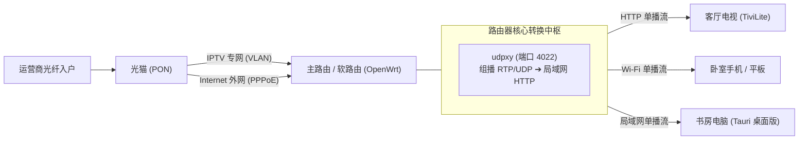

# 📺 TiviLite 家庭私有电视源自建与聚合全指南 (IPTV Self-Hosting Guide)

> 本指南专为追求**零卡顿、原画质（50fps）、永不失效、全屋设备共享**的流媒体发烧友与家庭用户设计。
> 结合 **TiviLite (灵动TV)** 的极速硬解、手机扫码秒推、局域网一键克隆等特性，带您从零打造属于自己的“私人电视台”。

---

## 目录
1. [方案对比与架构选型](#1-方案对比与架构选型)
2. [方案 A：运营商 IPTV 组播转单播（画质天花板，终极方案）](#2-方案-a运营商-iptv-组播转单播画质天花板终极方案)
   - [2.1 原理与拓扑架构](#21-原理与拓扑架构)
   - [2.2 光猫与单线复用 (VLAN) 配置](#22-光猫与单线复用-vlan-配置)
   - [2.3 路由器部署 udpxy 组播转单播](#23-路由器部署-udpxy-组播转单播)
   - [2.4 获取组播源并生成标准 M3U](#24-获取组播源并生成标准-m3u)
3. [方案 B：轻量 Docker 动态聚合代理（解决央视频 YSP / 防盗链失效）](#3-方案-b轻量-docker-动态聚合代理解决央视频-ysp--防盗链失效)
   - [3.1 痛点与原理解析](#31-痛点与原理解析)
   - [3.2 Docker Compose 一键部署实战](#32-docker-compose-一键部署实战)
   - [3.3 聚合输出 M3U 与 EPG 节目单](#33-聚合输出-m3u-与-epg-节目单)
4. [方案 C：公网 IPv6 高清源自建与自动化保活检测](#4-方案-c公网-ipv6-高清源自建与自动化保活检测)
   - [4.1 为什么优先选 IPv6 直播源？](#41-为什么优先选-ipv6-直播源)
   - [4.2 Python 自动批量测速与坏链剔除脚本](#42-python-自动批量测速与坏链剔除脚本)
5. [家庭私有 M3U 托管与 TiviLite 极速导入](#5-家庭私有-m3u-托管与-tivilite-极速导入)
   - [5.1 本地 NAS / WebDAV / Nginx 托管](#51-本地-nas--webdav--nginx-托管)
   - [5.2 手机扫码一键推送至电视](#52-手机扫码一键推送至电视)
   - [5.3 局域网全屋一键克隆 (UPHP)](#53-局域网全屋一键克隆-uphp)
6. [常见疑难排查与性能调优 (FAQ)](#6-常见疑难排查与性能调优-faq)

---

## 1. 方案对比与架构选型

| 方案模式 | 适用场景 | 优势 | 劣势 / 门槛 | 推荐指数 |
| :--- | :--- | :--- | :--- | :---: |
| **方案 A：运营商 IPTV 组播转单播** | 家中办理了电信/联通/移动带 IPTV 的宽带业务 | **原盘 50fps / 码率高达 10~25Mbps / 零延迟秒换台 / 彻底不占公网带宽** | 需要软路由/支持 OpenWrt 的路由器部署 `udpxy` | ⭐⭐⭐⭐⭐ (体验天花板) |
| **方案 B：Docker 动态鉴权聚合代理** | 有群晖/威联通/极空间 NAS，或软路由/云服务器 | **自动维护央视频、地方台动态 Token，彻底解决 403 鉴权过期** | 需要运行 Docker 容器 | ⭐⭐⭐⭐⭐ (省心免维护) |
| **方案 C：公网 IPv6 直播源聚合** | 无机顶盒/无 IPTV 业务，但家中宽带开启了 IPv6 | **全网通用，零硬件门槛，手机/平板出门也能看** | 依赖公网源服务器稳定性，需脚本保活 | ⭐⭐⭐⭐ (入门首选) |

---

## 2. 方案 A：运营商 IPTV 组播转单播（画质天花板，终极方案）

### 2.1 原理与拓扑架构
* **痛点**：运营商附送的机顶盒只能接光猫 IPTV 专用网口，且一台机顶盒只能连一台电视，界面广告冗长；
* **原理**：运营商广播的电视信号底层是 `RTP/UDP` 组播流（如 `rtp://239.x.x.x:port`）。通过软路由上的 `udpxy` 或 `msd_lite` 服务，将组播转换为局域网通用的 HTTP 单播协议（形如 `http://192.168.1.1:4022/udp/239.x.x.x:port`）。
* **收益**：家庭内所有电视、手机、iPad、电脑均可同时播放原画电视，互不干扰，不占用外网下载网速！



### 2.2 光猫与单线复用 (VLAN) 配置

#### 方式一：独立双线模式（最简单）
* 光猫千兆网口 1 接路由器 WAN 口（走外网上网）；
* 光猫 IPTV 口接路由器独立网口（设为 IPTV 专有接口，协议选“未配置”或“DHCP客户端”）。

#### 方式二：单线复用 VLAN 模式（进阶，光猫到路由器只需一根网线）
1. 用超级管理员登录光猫后台（Telecomadmin / cuadmin / cmccadmin）；
2. 找到【网络】->【绑定设置】/【VLAN绑定】：
   * 将上网连接（如 VLAN 41）与 IPTV 连接（如 VLAN 43）绑定至同一个 LAN 口（例如 LAN1）；
3. 路由器 OpenWrt 侧在 WAN 物理口上创建两个 VLAN 虚拟接口：
   * `eth0.41` 作为普通 WAN 口拨号；
   * `eth0.43` 作为 IPTV 接口，并开启 IGMP 组播侦听。

### 2.3 路由器部署 udpxy 组播转单播

#### 在 OpenWrt 路由器上安装配置：
1. 登录 OpenWrt 网页后台，进入【系统】->【软件包】，搜索并安装 `luci-app-udpxy`（或 SSH 执行 `opkg update && opkg install udpxy`）；
2. 进入【服务】->【udpxy】：
   * **已启用 (Enabled)**：勾选 ☑️
   * **端口 (Port)**：填入 `4022`
   * **来源网络接口 (Source Interface)**：选择连接光猫 IPTV 的接口（如 `eth0.43` 或 `iptv`）
   * **监听接口 (Bind IP)**：填入 `0.0.0.0`
   * **最大连接数**：建议 `10`
3. 保存并应用，在浏览器访问 `http://192.168.1.1:4022/status`，如果出现 **udpxy status** 网页，即代表部署成功！

### 2.4 获取组播源并生成标准 M3U

各省市运营商的组播地址可以通过**恩山无线论坛**搜索“`省份+运营商+IPTV组播`”（如“广东电信 IPTV 组播”），或直接将电脑插光猫 IPTV 口使用 Wireshark 抓包机顶盒开机数据获取。

#### 组播转单播转换规则：
* 原始组播地址：`rtp://239.77.0.1:5146`
* 转换后的 HTTP 地址：`http://192.168.1.1:4022/rtp/239.77.0.1:5146`
  *(若为 udp 协议则将路径改为 `/udp/239.x.x.x:port`)*

#### 生成的 `iptv_local.m3u` 文件样例：
```m3u
#EXTM3U x-tvg-url="http://epg.51zmt.top:8000/api/diyp/"
#EXTINF:-1 tvg-name="CCTV1" tvg-id="CCTV1" tvg-logo="https://live.fanmingming.com/tv/CCTV1.png" group-title="央视频道",CCTV-1 综合 (原画50fps)
http://192.168.1.1:4022/rtp/239.77.0.1:5146
#EXTINF:-1 tvg-name="CCTV5" tvg-id="CCTV5" tvg-logo="https://live.fanmingming.com/tv/CCTV5.png" group-title="央视频道",CCTV-5 体育 (原画50fps)
http://192.168.1.1:4022/rtp/239.77.0.5:5146
#EXTINF:-1 tvg-name="湖南卫视" tvg-id="湖南卫视" tvg-logo="https://live.fanmingming.com/tv/湖南卫视.png" group-title="卫视频道",湖南卫视高清
http://192.168.1.1:4022/rtp/239.77.1.10:5146
```

---

## 3. 方案 B：轻量 Docker 动态聚合代理（解决央视频 YSP / 防盗链失效）

### 3.1 痛点与原理解析
* **痛点**：央视频（yangshipin）、各大卫视官网直播流，地址末尾带动态防盗链签名 `?auth_key=...`，通常 1~2 小时就会失效并返回 403 Forbidden；
* **原理**：在 NAS（群晖、极空间、威联通、Unraid）或云服务器上搭建一个开源轻量代理容器（如 Pixman / AllInOne / mytv-tools）。代理服务每隔一段时间自动调用官方 API 刷新 Token，并将流转接出来。播放器只需要请求代理服务器，即可获得**永不失效的永久直播流**。

### 3.2 Docker Compose 一键部署实战

在安装了 Docker 的设备上创建目录 `mkdir -p ~/iptv_proxy && cd ~/iptv_proxy`，编写 `docker-compose.yml`：

```yaml
version: '3.8'

services:
  # 央视频与各平台动态鉴权聚合代理
  pixman-iptv:
    image: pixman/pixman-iptv:latest
    container_name: iptv_dynamic_proxy
    restart: unless-stopped
    ports:
      - "5000:5000"
    environment:
      - TZ=Asia/Shanghai
      # 可选注入专属代理与缓存优化
      - HTTP_PROXY=
    volumes:
      - ./data:/data
```

启动容器：
```bash
docker-compose up -d
```

### 3.3 聚合输出 M3U 与 EPG 节目单
部署完成后，容器会自动在本地 `5000` 端口生成标准 M3U 订阅源与配套 EPG：
* **动态央视/卫视 M3U 地址**：`http://[NAS内网IP]:5000/ysp.m3u`
* **配套精准 EPG 节目单地址**：`http://[NAS内网IP]:5000/epg.xml`

将这个 URL 直接填入 TiviLite，即刻告别 CCTV-14 少儿频道或卫视频道频繁加载不出的烦恼！

---

## 4. 方案 C：公网 IPv6 高清源自建与自动化保活检测

### 4.1 为什么优先选 IPv6 直播源？
1. **不限速、不拥堵**：国内移动、电信、联通及教育网（CERNET）骨干网均已开通原生 IPv6，公网直连互通，几乎没有 QoS 限速；
2. **纯净直接**：许多高校电视台（如清华、中科大、浙大）或运营商开放测试节点直接吐出 1080p TS 分片，无鉴权、无水印、无弹窗广告。

### 4.2 Python 自动批量测速与坏链剔除脚本

如果从网络上搜集了一批公网直播源，可以用以下我们编写的轻量 Python 脚本进行自动化健康检查与清洗，剔除死链，只保留秒开的高速可用源。

在你的电脑或服务器上创建 `iptv_cleaner.py`：

```python
#!/usr/bin/env python3
# -*- coding: utf-8 -*-
"""
TiviLite 极轻量 M3U 直播源存活检测与自动化清洗工具
功能：多线程并发并发探测 HTTP/HLS 流有效性与响应延迟，自动剔除死链
"""

import urllib.request
import time
import concurrent.futures

INPUT_FILE = "raw_sources.m3u"
OUTPUT_FILE = "clean_channels.m3u"
TIMEOUT_SECONDS = 3.0
MAX_WORKERS = 16

def test_stream(channel_name, url):
    start_time = time.time()
    try:
        req = urllib.request.Request(
            url,
            headers={
                "User-Agent": "Mozilla/5.0 (Windows NT 10.0; Win64; x64) AppleWebKit/537.36",
                "Referer": "https://www.yangshipin.cn/"
            }
        )
        with urllib.request.urlopen(req, timeout=TIMEOUT_SECONDS) as response:
            if response.status == 200:
                latency_ms = int((time.time() - start_time) * 1000)
                return True, latency_ms
    except Exception:
        pass
    return False, 9999

def clean_m3u():
    print(f"[*] 开始读取直播源文件: {INPUT_FILE}...")
    try:
        with open(INPUT_FILE, "r", encoding="utf-8") as f:
            lines = f.readlines()
    except FileNotFoundError:
        print(f"[!] 找不到文件 {INPUT_FILE}，请先放置待检测的 M3U 文件！")
        return

    channels_to_test = []
    i = 0
    while i < len(lines):
        line = lines[i].strip()
        if line.startswith("#EXTINF:"):
            name = line.split(",")[-1]
            if i + 1 < len(lines) and not lines[i+1].startswith("#"):
                url = lines[i+1].strip()
                channels_to_test.append((line, name, url))
                i += 1
        i += 1

    print(f"[*] 成功解析出 {len(channels_to_test)} 个频道，启动 {MAX_WORKERS} 线程高并发测速...")

    valid_channels = []
    with concurrent.futures.ThreadPoolExecutor(max_workers=MAX_WORKERS) as executor:
        future_map = {
            executor.submit(test_stream, name, url): (extinf, name, url)
            for extinf, name, url in channels_to_test
        }
        for future in concurrent.futures.as_completed(future_map):
            extinf, name, url = future_map[future]
            is_alive, latency = future.result()
            if is_alive:
                print(f"  [✓ 存活] {name} - 响应耗时: {latency}ms")
                valid_channels.append((extinf, url, latency))
            else:
                print(f"  [✗ 失效] {name} - 丢弃")

    # 按响应延迟从低到高排序
    valid_channels.sort(key=lambda x: x[2])

    with open(OUTPUT_FILE, "w", encoding="utf-8") as f:
        f.write("#EXTM3U name=\"TiviLite 私有优化清洗源\"\n")
        for extinf, url, latency in valid_channels:
            f.write(f"{extinf}\n{url}\n")

    print(f"\n[🎉 检测完成] 共剔除 {len(channels_to_test) - len(valid_channels)} 个死链！")
    print(f"[✓] 高可用清洗源已导出至: {OUTPUT_FILE} (共 {len(valid_channels)} 个超快频道)")

if __name__ == "__main__":
    clean_m3u()
```

运行检测：
```bash
python3 iptv_cleaner.py
```

---

## 5. 家庭私有 M3U 托管与 TiviLite 极速导入

整理好的 `clean_channels.m3u` 如何最优雅地分发给全家人的所有设备？

### 5.1 本地 NAS / WebDAV / Nginx 托管
如果您有家庭 NAS 或软路由，建议建立一个静态 HTTP 服务托管它：
* **方法 1：极简 Python 一键开启局域网 HTTP 服务**：
  ```bash
  # 在保存了 clean_channels.m3u 的目录下执行：
  python3 -m http.server 8088
  ```
  此时局域网内订阅链接即为：`http://192.168.1.X:8088/clean_channels.m3u`。
* **方法 2：群晖 Web Station / Nginx**：
  将文件拖放到 Web 根目录即可生成永久 HTTP/HTTPS 内网链接。

### 5.2 手机扫码一键推送至电视（TiviLite 专属利器）
彻底不需要拿 U 盘拷文件，也不需要用遥控器笨拙地打字：
1. 打开电视上的 **TiviLite (灵动TV)**，按遥控器菜单键或进入设置，点击 **【扫码配源 / Web后台】**；
2. 电视屏幕立即弹出局域网专用动态二维码与 IP（如 `http://192.168.1.100:8080`）；
3. 拿起手机微信或浏览器扫一扫，手机端进入精致的控制台：
   * **订阅链接导入**：直接在手机端粘贴您的 M3U URL；
   * **本地文件上传**：点击上传刚才生成的 `clean_channels.m3u`；
   * **直接粘贴 M3U 文本**：直接把频道文本贴进输入框；
4. 点击手机界面的 **【立即推送到电视】**，电视画面在 0.2 秒内瞬间加载起播！

### 5.3 局域网全屋一键克隆 (UPHP 协议)
当客厅的电视已经配好最完美的电视频道后：
* 走进卧室打开卧室电视（或拿出手上的平板/手机）；
* 打开 TiviLite，在弹出的欢迎页点击 **【👯 局域网同频克隆】**；
* 软件利用 UDP 自动探测局域网内的客厅主机，0.5 秒直接无感同步所有订阅源、分类与收藏夹，无需二次配置！

---

## 6. 常见疑难排查与性能调优 (FAQ)

### Q1：使用 udpxy 组播转单播，电视换台有时会转圈卡顿或花屏？
* **原因**：Wi-Fi 组播转单播突发风暴导致的无线丢包。
* **解决办法**：
  1. 路由器无线设置中，确保开启 **【IGMP 侦听 (IGMP Snooping)】**，关闭无线多播速率限制；
  2. 电视端建议优先插网线连接路由器；若走 Wi-Fi，请确保连接 5GHz 频段，避开 2.4GHz 干扰；
  3. 在 TiviLite 设置中，将【缓冲引擎】模式切换为 **【平稳防抖】**（预置 2500ms 缓冲区）。

### Q2：CCTV-14 少儿频道或部分地方台播着播着突然停住？
* **原因**：该频道源采用了动态防盗链，旧的 Token 已被服务端注销。
* **解决办法**：
  1. 确保已更新到 TiviLite v2.1.0+，已内置 `ysp_cctv_resolver` 自动穿透；
  2. 参考本文 **方案 B**，搭建一个 Docker 代理，转接为永不失效的本地直播流；
  3. 配置多线路备用源：在 M3U 中为该频道配置多条不同运营商/公网的备用地址，TiviLite 检测到 403 错误时会在 400ms 内瞬间自动切换至下一条备用线路。

### Q3：4K 频道有声音但黑屏，或者播放画面一卡一顿？
* **解决办法**：
  1. 在 TiviLite 设置中进入 **【解码引擎】**；
  2. 若当前为“软解”，切换为 **【GPU 硬件加速 (MediaCodec)】**，充分调用电视芯片的硬件解码能力；
  3. 若老旧电视盒子芯片不支持高规格 10-bit HEVC 硬解，切换为【软件解码 (FFmpeg)】尝试流畅回退。

---

> 💡 **小贴士**：收藏本文档，配合最新版 [TiviLite Releases](https://github.com/fullofjoy/tivilite/releases) 客户端，即可在客厅与全终端享受极致的视听盛宴！
